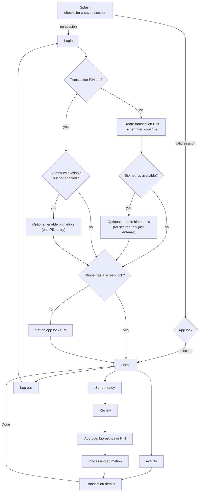

# jWallet Lite

A Flutter mobile wallet: sign in, check your balance, send money, and browse your transaction history. It talks to a hosted backend over an end-to-end encrypted channel and protects money movement with a transaction PIN and optional biometrics.

> **Please read: how transfers work**
>
> Transfers are **partly real, partly simulated**.
>
> - **Real:** the sender's wallet is genuinely debited in the backend database. Your balance goes down, the transaction is recorded, and it shows up in Home and Activity.
> - **Simulated:** the recipient is only a *name and mobile number* saved on your transaction record. The backend does not look the number up, and **no money is credited to any account**. "Rahul Sharma" never actually receives anything.
> - The CREDIT entries you see in history are demo data created when the database is seeded. A transfer never creates one.
>
> A few controls are demo-only as well: **Add money**, **CSV / PDF export**, the **All Types** filter, the **profile** icon, and the **Quick Send** contacts (local demo contacts).

## Contents

- [Features](#features)
- [App flow](#app-flow)
- [Architecture](#architecture)
- [Important packages](#important-packages)
- [Security design](#security-design)
- [Getting started](#getting-started)
- [Project structure](#project-structure)
- [Testing](#testing)
- [Limitations](#limitations)

## Features

- **Sign in** with email and password, with a saved session that is restored on the next launch.
- **Transaction PIN** (4 or 6 digits), created once after the first sign-in. Needed to approve transfers.
- **Biometric approval** (fingerprint or face) as a faster alternative to the PIN.
- **App lock**: opens with the phone's own screen lock, or an app-owned PIN if the phone has none.
- **Home**: balance, quick send shortcuts, recent activity, and a demo QR code.
- **Send money**: amount keypad, recipient picker, optional note, review, approval, and a processing animation that flies into the transaction details.
- **Activity**: the full history with search, type, status and month filters, grouped by day and loaded page by page.
- **Transaction details**: amount, status, date, recipient, note and reference (tap to copy).
- **Log out**: calls the logout API, clears everything the app saved on the phone, and returns to the login screen.
- Portrait only, dark theme, and layouts that fit small and large phones without scrolling where possible.

## App flow



### Sending money, step by step

1. **Choose who and how much.** From Home, tap Send, or a Quick Send contact. Pick a saved contact or enter a new name and 10-digit mobile number, then type the amount (or use the +₹500 / ₹1,500 / +₹2,000 / Max chips) and an optional note. The balance comes from the API, and an amount over it is flagged.
2. **Review.** The app asks the backend to check the transfer (balance, per-transfer and daily limits). The backend returns a one-time **challenge** that expires after about two minutes.
3. **Approve.** Use biometrics (the phone signs the challenge with a key that never leaves its secure hardware) or enter your transaction PIN.
4. **Processing.** The coin and breathing gradient animation plays while the transfer is sent with an idempotency key.
5. **Done.** The coin flies into the transaction details. Home and Activity refresh automatically.

If the network drops mid-transfer, retrying uses the same idempotency key, so the backend returns the original result instead of paying twice.

### Sign-in and PIN rules

- A wrong transaction PIN shows the server's message with the attempts left. Too many wrong attempts lock the PIN on the server.
- The app lock locks the app on launch and again after it has been in the background for 30 seconds. A sign-in you just made does not ask again.
- App-owned lock PIN (only on phones without a screen lock): stored as a salted hash, five wrong tries lock it for five minutes, and it is removed on log out.

## Architecture

The app is **feature-first**, with a small shared `core`. Each feature is split into three layers, and dependencies only point inward:

```
View (widgets)  →  Cubit (state)  →  Repository (data)  →  AuthenticatedClient  →  ApiClient  →  Dio
```

| Layer | Responsibility |
| --- | --- |
| **View** (`view/`) | Widgets only. Reads state, calls cubit methods. No networking, no business rules. |
| **Cubit** (`view_model/`) | Holds screen state (`flutter_bloc`), validates input, decides what happens next. |
| **Repository** (`data/`) | Talks to the API, parses responses into models, hides the HTTP details. |
| **`core/`** | Shared building blocks: encrypted networking, token handling, secure storage, device keys, theme, validators and reusable widgets. |

### How the pieces fit together

- **State management**: `Cubit`s with `Equatable` states. Screen cubits are created per route; a few app-wide ones (session, app lock) live for the whole run.
- **Dependency injection**: `get_it`. Everything is registered in one place, `app/di.dart`.
- **Navigation**: `go_router` with one `redirect` function that holds all access rules, so screens never ask "am I signed in?". Home and Activity are two tabs in a `StatefulShellRoute`, which keeps each tab's data and scroll position.
- **Session** (`app/session/`): one app-wide state that says signed out, signed in without a PIN, signed in with a PIN, and so on. The router reacts to it.
- **App lock** (`features/app_lock/`): a gate that wraps the whole app. While it is locked it covers everything, and the screens underneath keep their state.
- **Networking** (`core/network/`):
  - `ApiClient` encrypts every request and decrypts every response.
  - `AuthenticatedClient` adds the access token, and when it expires it refreshes it **once**, even if several requests expire together, then retries.
  - Server errors become an `ApiException` that carries the API's own message, which is shown to the user in a snackbar.
- **Events**: a tiny `WalletEvents` stream tells Home and Activity to refresh after a transfer, so screens do not need to know about each other.
- **Native code**: Kotlin (Android) and Swift (iOS) implement the device keys: a signing key and a biometric-protected key kept in the Android Keystore or iOS Keychain / Secure Enclave. Dart only ever sees public keys and signatures.
- **UI system**: a shared dark theme and brand gradient, plus reusable pieces such as `PinScreenLayout` (every PIN screen), `PinKeypad` (PIN and amount entry) and `AppButton`. Sizing uses `flutter_screenutil_plus` (`.w`, `.h`, `.r`, `.sp`).

## Important packages

Only the packages that shape the app are listed here. See `pubspec.yaml` for everything.

| Package | Why it is used |
| --- | --- |
| [`flutter_bloc`](https://pub.dev/packages/flutter_bloc) | State management with Cubits. Keeps screens simple and logic testable. |
| [`equatable`](https://pub.dev/packages/equatable) | Value equality for states and models, so the UI only rebuilds when something really changed. |
| [`go_router`](https://pub.dev/packages/go_router) | Declarative navigation, centralised sign-in guards and the tabbed shell. |
| [`get_it`](https://pub.dev/packages/get_it) | Dependency injection and a single place to wire repositories and cubits. |
| [`dio`](https://pub.dev/packages/dio) | HTTP client with timeouts, headers and error types. |
| [`pointycastle`](https://pub.dev/packages/pointycastle) | The cryptography behind the encrypted channel (ECDH P-256, HKDF, AES-GCM) and the app-lock PIN hash (PBKDF2). |
| [`flutter_secure_storage`](https://pub.dev/packages/flutter_secure_storage) | Keeps tokens, the device ID and the app-lock PIN record in the Keystore / Keychain. |
| [`local_auth`](https://pub.dev/packages/local_auth) | Unlocks the app with the phone's own screen lock, fingerprint or face. |
| [`flutter_screenutil_plus`](https://pub.dev/packages/flutter_screenutil_plus) | Responsive sizing so one design works across phone sizes. |
| [`google_fonts`](https://pub.dev/packages/google_fonts) | Space Grotesk and Geist, loaded from bundled font files (no runtime download). |
| [`material_ui`](https://pub.dev/packages/material_ui) | The Material widgets, as the standalone package that replaces the built-in Material library. |
| [`qr_flutter`](https://pub.dev/packages/qr_flutter) | Draws the demo QR code on Home. |
| [`intl`](https://pub.dev/packages/intl) | Indian-style number grouping (₹1,00,000) and date formatting. |
| [`uuid`](https://pub.dev/packages/uuid) | Device ID and the idempotency key for each transfer. |
| [`mocktail`](https://pub.dev/packages/mocktail) *(dev)* | Mocks for repository, client and cubit tests. |

## Security design

- **Encrypted payloads.** Every request and response body is encrypted on top of HTTPS: a fresh ECDH P-256 key per request, HKDF-SHA256, and AES-256-GCM. The method, path and a nonce are bound to the ciphertext, so a captured request cannot be altered or replayed on another endpoint.
- **Short-lived access, rotating refresh.** The access token lasts about 15 minutes. The refresh token works once and is replaced on every use. The app signs each refresh with a key held in secure hardware, so a copied token is useless on another phone. If the server may already have used a refresh token (a lost response, for example), the session ends rather than replaying it. If the request provably never reached the server (offline), the session is kept.
- **Approval for every transfer.** A one-time server challenge is approved with a biometric signature or the transaction PIN. The challenge is bound to the exact recipient, amount and note, so nothing can change after you approve.
- **PIN handling.** The transaction PIN is only ever sent to the server (which stores a hash). The app holds only the digits you are typing (plus, during first-time setup, the PIN you just confirmed while the optional biometric step is open) and wipes them when the app goes to the background.
- **Secure storage and logout.** Tokens and the app-lock record live in the Keystore / Keychain. Logging out calls the logout API, then clears everything the app saved.

## Getting started

### Requirements

- Flutter 3.50 or newer (Dart 3.14)
- Android 7.0 (API 24) or newer, or a current iOS device or simulator
- Node.js, only to run one of the encryption tests

### Run

```sh
flutter pub get
flutter run --dart-define-from-file=env/local.json
```

The app uses the hosted backend `https://jwallet-backend.onrender.com` for both debug and release, so no local server is needed. The service may take up to a minute to wake up on the first request.

### Demo account

| Email | Password |
| --- | --- |
| `demo@jstack.co` | `Demo@123` |

The account starts with a seeded balance and sample history.

### Configuration

`env/local.json` and `env/prod.json` hold public settings only. They are optional, because the same values are the defaults in `AppConfig`.

| Key | Meaning |
| --- | --- |
| `API_BASE_URL` | The backend origin, without a trailing slash. |
| `ENC_KEY_ID` | The ID of the server's encryption key. |
| `ENC_PUBLIC_KEY` | The server's P-256 **public** key (base64). It must match the server. Never put a private key here. |

### Build

```sh
flutter build apk --release --dart-define-from-file=env/prod.json
```

## Project structure

```
lib/
├── main.dart                 # entry point: portrait lock, DI, session start
├── app/
│   ├── app.dart              # MaterialApp.router, providers, app lock gate
│   ├── di.dart               # every dependency, registered in one place
│   ├── router/               # routes, access rules, tab shell
│   └── session/              # app-wide signed-in state
├── core/
│   ├── config/               # API base URL and encryption public key
│   ├── crypto/               # encrypted channel, device keys, PIN hashing
│   ├── events/               # "wallet changed" signal
│   ├── network/              # ApiClient, AuthenticatedClient, ApiException
│   ├── storage/              # secure storage
│   ├── theme/                # colours, gradient, text and component themes
│   ├── utils/                # validators and formatters
│   └── widgets/              # buttons, fields, PIN layout, keypad, snackbar
└── features/
    ├── splash/               # shown while the saved session is checked
    ├── auth/                 # login
    ├── security/             # transaction PIN and biometric setup
    ├── app_lock/             # screen-lock / app-PIN lock and its gate
    ├── home/                 # balance, quick send, recent activity
    ├── transfer/             # amount, review, approval, processing
    ├── activity/             # filtered, paged history
    └── transactions/         # single transaction details
android/ , ios/               # native device-key and biometric code
test/                         # unit, widget and end-to-end flow tests
```

### API endpoints used

All paths are under `/api/v1`.

| Endpoint | Used for |
| --- | --- |
| `POST /auth/login`, `/auth/refresh`, `/auth/logout` | Sign in, token refresh, log out |
| `GET /users/profile` | Name, initials, PIN and biometric status |
| `GET /wallet/balance` | Available balance and masked account number |
| `GET /transactions` | History (type, status, search, month, paging) |
| `GET /transactions/:id` | Transaction details |
| `POST /transactions/transfer/challenge` | Check a transfer and get an approval challenge |
| `POST /transactions/transfer` | Send the approved transfer |
| `POST /security/pin` | Create the transaction PIN |
| `POST /devices/biometric` | Enable biometric approval |

Responses use one envelope for success and errors: `{ "meta": { "statusCode", "message" }, "body": { ... } }`. The `meta.message` of a failed call is what the user sees in a snackbar.

## Testing

```sh
flutter analyze
flutter test
```

The suite covers the cubits and repositories, token refresh and session handling, the PIN and app-lock logic, the amount and filter rules, the main screens at several phone sizes and text scales, and a flow test that drives the real router from Home through sending money to the transaction details and back, and through log out. One test checks the Dart encryption against an independent Node implementation, which is why Node is needed.

## Limitations

- Transfers are simulated on the recipient side: nothing is credited to the recipient (see the note at the top).
- Add money, CSV / PDF export, the All Types filter, the profile icon and the Quick Send contacts are demo-only.
- The History filters are applied by the backend; the transaction categories shown in some designs are not available from the API.
- Logging out removes everything the app stored, but the keys held in the Android Keystore / iOS Keychain are left in place. They cannot be used without a matching server-side enrolment.
